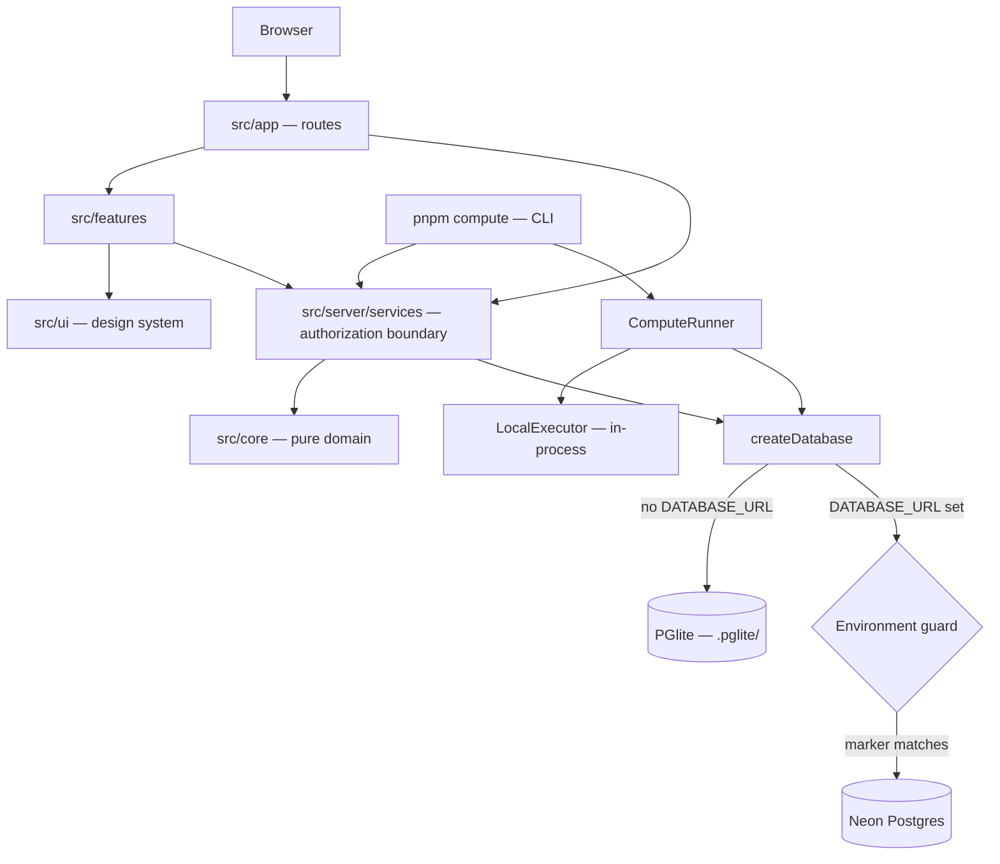

# Faultline

**Don't grade the answer. Debug the reasoning.**

[](https://github.com/GeheshbabuD/Faultline/actions/workflows/ci.yml)


Faultline is an educational web application that looks at *how* a student reached an
answer, not only *whether* the answer is right. Its goal is to find the step where a
student's reasoning first diverged from a sound path, to name the misconception behind
that step against a curated taxonomy, and to check whether a repair carries over to a
new problem.

> **Project status:** early development. The reasoning workspace, data model, database
> safety guard and background-compute foundation are built. The analysis that gives
> Faultline its name — reasoning comparison and misconception diagnosis — is in
> progress and planned work. See [Current implementation status](#current-implementation-status).

---

## Contents

- [Overview](#overview)
- [The problem](#the-problem)
- [Vision and objectives](#vision-and-objectives)
- [How Faultline works](#how-faultline-works)
- [Core features](#core-features)
- [Architecture overview](#architecture-overview)
- [Technology stack](#technology-stack)
- [Project structure](#project-structure)
- [Prerequisites](#prerequisites)
- [Local installation](#local-installation)
- [Environment configuration](#environment-configuration)
- [Database setup](#database-setup)
- [Development commands](#development-commands)
- [Testing and verification](#testing-and-verification)
- [Security considerations](#security-considerations)
- [Current implementation status](#current-implementation-status)
- [Development roadmap](#development-roadmap)
- [Contributing](#contributing)
- [License](#license)
- [Acknowledgements](#acknowledgements)

---

## Overview

Faultline is a single Next.js application backed by PostgreSQL. A student works a
problem step by step in a guided **reasoning workspace**; each step is recorded, so the
system holds a full reasoning trace rather than a single final answer. Problems ship
with authored **canonical reasoning paths** that later phases compare traces against.

The first subject is **integer subtraction** — eight authored problems, including one
where the most common wrong rule happens to produce the right answer, which is exactly
the case answer-only grading cannot see.

## The problem

Most educational software checks the final answer. That hides two things teachers
care about:

- **A correct answer reached by faulty reasoning** is marked right, and the
  misconception survives to cause errors later.
- **A wrong answer from mostly sound reasoning** is marked wrong, with no indication of
  the single step that went astray.

Teachers can inspect reasoning one script at a time, but not at scale. Faultline aims
to make the reasoning itself the object of feedback.

## Vision and objectives

1. **Locate** the first step where a student's reasoning diverges from a canonical path.
2. **Classify** the misconception behind it against a curated, version-controlled
   taxonomy — never a free-form label invented on the fly.
3. **Verify repair** by checking whether a corrected understanding transfers to a new
   context.
4. **Stay honest about uncertainty.** Diagnoses carry confidence bands, and a low
   confidence reading is shown as uncertain rather than presented as fact.
5. **Describe evidence, not students.** Diagnoses are designed as append-only events
   ("observed 4 times"), never as mutable attributes of a person ("is bad at maths").
6. **Stay subject-independent.** New subjects are added as content (problems,
   reference solutions, taxonomy), not by changing engines.

## How Faultline works

| Stage | What happens | Status |
| --- | --- | --- |
| 1. Practice | The student picks a problem and works it step by step in the reasoning workspace (`/practice/[slug]`). | **Implemented** |
| 2. Record | The attempt, every reasoning step and the final answer are stored. Answer correctness and reasoning status are independent columns, so "right answer, faulty reasoning" is representable. | **Implemented** |
| 3. Review | A recorded trace can be revisited at `/attempts/[id]`. | **Implemented** |
| 4. Compare | Each student step is compared with the matching canonical step to find where the reasoning first diverges. | **In progress** (Phase 3) — the comparison input (step pairing with invariant checks) and the reasoning-diff contract exist as pure code; no AI provider or comparison engine is wired in yet. |
| 5. Diagnose | The divergence is classified against a curated misconception taxonomy, with a confidence band. | **Planned** (Phase 4) |
| 6. Repair and transfer | Targeted follow-up problems check whether the repair carries over. | **Planned** |

## Core features

Legend: ✅ implemented · 🟡 in progress · ⬜ planned

| | Feature | Notes |
| --- | --- | --- |
| ✅ | Authored content with validated canonical reasoning | `content/` — 8 integer-subtraction problems; schema-validated in tests |
| ✅ | Guided reasoning workspace | Step-by-step stepper; each step can be typed or dictated |
| ✅ | Attempt and reasoning-trace persistence | Attempts, steps, answers; trace review page |
| ✅ | Design system | Rendered live at `/design`; a "reasoning path" visual that offsets the rail at a divergence |
| ✅ | Enforced architecture boundaries | Layer rules checked by ESLint, not by convention |
| ✅ | Zero-credential local development | Local PGlite database, auto-migrated and auto-seeded |
| ✅ | Database environment guard | Refuses any Neon database whose environment marker does not match configuration |
| ✅ | Background compute foundation | Database-backed job queue, runner, `LocalExecutor`, `pnpm compute` CLI |
| 🟡 | Reasoning comparison (Phase 3) | Step pairing, diff contract and confidence policy exist; not wired to the product |
| 🟡 | Neon development database provisioning | Verified and inspected; marking the database is pending |
| ⬜ | Misconception classification (Phase 4) | Curated taxonomy + closed-set classifier |
| ⬜ | Repair and transfer checks | Follow-up problems that test whether a repair holds |
| ⬜ | Real authentication (Phase 8) | Today a deterministic development user stands in |
| ⬜ | Distributed compute (compute Phase C onward) | A Dask executor behind the existing executor seam — **not implemented** |

## Architecture overview

Faultline is one Next.js application with enforced internal layers. Each layer may
depend only on the layers listed above it:

```
content/          Authored taxonomy and problems. Data, not code.
src/core/         Pure domain logic. No framework, database, network or AI.
src/ai/           Provider-agnostic model layer (planned; only its contract exists).
src/server/       Persistence, services, compute, configuration. Server-only.
src/ui/           Design-system primitives.
src/features/     Feature composition.
src/app/          Routes. Thin.
```

`eslint.config.mjs` enforces these rules: for example, a `src/core` file that imports
`next` or `@/server/*` fails `pnpm lint`, and routes and components may not query the
database except through `src/server/services`.



### Compute layer

Slow or broad work (batch evaluation, reports, analytics) runs as **compute jobs**:

- **Queue** — jobs and attempts live in Postgres (`compute_jobs`, `compute_job_attempts`).
  Every state change is a compare-and-set update; the database enforces lifecycle
  invariants as check constraints.
- **Runner** — claims one job at a time (`FOR UPDATE SKIP LOCKED`), holds a renewable
  lease, loads data inside a **read-only transaction**, executes, validates the output
  and settles. A stale runner's late result is fenced out.
- **`LocalExecutor`** — runs tasks in-process on Node. It is the only executor today and
  remains the permanent fallback.
- **CLI** — `pnpm compute` submits, runs, inspects and cancels jobs.
- **Dask integration is not implemented.** The `ComputeExecutor` interface is the seam a
  future distributed executor (compute Phase C) would implement; Phase C has not started.

Details: [docs/compute.md](docs/compute.md). Design decisions:
[docs/architecture.md](docs/architecture.md).

## Technology stack

| Area | Technology |
| --- | --- |
| Framework | [Next.js](https://nextjs.org/) 16 (App Router), [React](https://react.dev/) 19 |
| Language | [TypeScript](https://www.typescriptlang.org/) 6 (strict) |
| Styling | [Tailwind CSS](https://tailwindcss.com/) 4, Radix Slot, Lucide icons |
| Database | PostgreSQL — [Neon](https://neon.tech/) serverless driver; [PGlite](https://pglite.dev/) (Postgres in WASM) locally and in tests |
| ORM and migrations | [Drizzle ORM](https://orm.drizzle.team/) and drizzle-kit |
| Validation | [Zod](https://zod.dev/) 4 |
| Unit and component tests | [Vitest](https://vitest.dev/) 4, Testing Library, happy-dom |
| End-to-end tests | [Playwright](https://playwright.dev/) — desktop, tablet and mobile profiles |
| Tooling | ESLint 9, tsx, pnpm 10, Node.js 22, GitHub Actions |
| AI provider (planned) | Anthropic SDK is installed for Phase 3; no feature calls a model yet |

## Project structure

```
.
├── content/                    Authored problems, concepts and reference reasoning
├── docs/                       Architecture, development, compute and database guides
├── e2e/                        Playwright end-to-end tests
├── src/
│   ├── app/                    Routes: /, /practice, /practice/[slug], /attempts/[attemptId], /design
│   ├── core/                   Pure domain logic
│   │   ├── answer/             Answer checking and re-checking
│   │   ├── attempt/            Submission rules
│   │   ├── compute/            Job contracts: canonical JSON, failure codes, state machine
│   │   ├── content/            Content schema and loading
│   │   ├── diagnosis/          Confidence policy (Phase 3, in progress)
│   │   ├── environment/        Database-guard decisions (pure)
│   │   └── reasoning/          Comparison input and diff contract (Phase 3, in progress)
│   ├── ai/                     Planned model layer (contract only)
│   ├── features/
│   │   └── reasoning-stepper/  The guided reasoning workspace
│   ├── server/
│   │   ├── auth/               Development actor (real auth is Phase 8)
│   │   ├── compute/            Runner, LocalExecutor, task registry, job store, CLI
│   │   ├── config/             Environment contract
│   │   ├── db/                 Schema, migrations, clients, guard, PGlite lock, provisioning SQL
│   │   └── services/           Authorization boundary: problems, attempts, compute jobs
│   ├── ui/                     Design-system primitives, layout, feedback, reasoning path
│   ├── lib/                    Small shared helpers
│   └── test/                   Test helpers (in-memory database, stubs)
├── .github/                    CI workflow, issue and pull-request templates
├── drizzle.config.ts           drizzle-kit configuration (guarded)
├── eslint.config.mjs           Lint rules, including layer boundaries
├── playwright.config.ts
└── vitest.config.mts
```

## Prerequisites

- **Node.js 22** — see `.nvmrc`; CI runs on Node 22.
- **pnpm 10.15.0** — pinned by `packageManager` in `package.json`; `corepack enable`
  provides it.
- **Git.**
- *Optional:* Playwright browsers for end-to-end tests
  (`pnpm exec playwright install chromium webkit`).
- *Optional:* a [Neon](https://neon.tech/) project, only if you want a hosted Postgres
  database instead of the local one.

## Local installation

```bash
git clone https://github.com/GeheshbabuD/Faultline.git
cd Faultline
corepack enable
pnpm install
pnpm dev
```

Open <http://localhost:3000>. No credentials are needed: without `DATABASE_URL`,
Faultline creates a local PGlite database in `.pglite/`, migrates it and seeds the
authored content on first boot, and logs a warning saying so.

| Route | Purpose |
| --- | --- |
| `/` | Product statement |
| `/practice` | The authored problem set |
| `/practice/[slug]` | The guided reasoning workspace |
| `/attempts/[attemptId]` | A recorded reasoning trace |
| `/design` | The design-system reference, every primitive rendered live |

## Environment configuration

Copy the template and fill in only what you need:

```bash
cp .env.example .env.local
```

`.env.local` is git-ignored. Never commit real values.

| Variable | Required | Purpose |
| --- | --- | --- |
| `DATABASE_URL` | Production; optional in development | Pooled Neon connection string. Leave empty to use local PGlite. Contains a password. |
| `FAULTLINE_DB_ENVIRONMENT` | Whenever `DATABASE_URL` is set | `development` or `production` — what the database's environment marker must say. |
| `FAULTLINE_DB_ID` | Whenever `DATABASE_URL` is set | The marker's `database_id` (a UUID). An identifier, not a secret. |
| `ANTHROPIC_API_KEY` | Not yet | Reserved for Phase 3. Server-side only; never prefix with `NEXT_PUBLIC_`. |

Define each variable once in `.env.local` and do not also export it in your shell: the
database guard refuses a configuration where the two disagree.

## Database setup

### Local (default): PGlite

Nothing to set up. `pnpm dev` creates `.pglite/`, applies migrations and seeds content.

PGlite is single-process: only one process may open `.pglite/` at a time. The CLI tools
(`pnpm compute`, `pnpm db:migrate`, `pnpm db:seed`) hold a lock file (`.pglite.lock`)
and refuse to start while `pnpm dev` is running, and the dev server refuses while one
of them holds the lock. **Stop `pnpm dev` before running a CLI command against PGlite.**

To start over, stop every Faultline process and delete `.pglite/`; it is recreated on
the next boot.

### Hosted: Neon

Faultline refuses to use a Neon database until that database carries an **environment
marker** — a single row in `faultline_environment` — that matches
`FAULTLINE_DB_ENVIRONMENT` and `FAULTLINE_DB_ID`. A production-marked database is also
refused to any process not running with `NODE_ENV=production`.

1. Create a Neon project or branch for development. Never branch development from
   production: a branch copies its parent's data.
2. A person marks the database once, in the Neon SQL editor, using
   [`src/server/db/provisioning/mark-database.sql`](src/server/db/provisioning/mark-database.sql).
   No application code, migration or seed ever writes the marker.
3. Put the pooled connection string, the environment and the returned `database_id` in
   `.env.local`.
4. Apply migrations and seed content explicitly: `pnpm db:migrate`, then `pnpm db:seed`.

Every command prints which database it verified before doing anything. The full rules
and refusal codes are in [docs/database-environment.md](docs/database-environment.md).

> **Status:** the project's own Neon development database has been verified and
> inspected, but has **not yet been marked**, so no migrations or seeds have been
> applied to it. Local PGlite is the working development database today.

## Development commands

All commands are `package.json` scripts:

| Command | What it does |
| --- | --- |
| `pnpm dev` | Start the development server |
| `pnpm build` | Production build (fails on type errors) |
| `pnpm start` | Serve a production build |
| `pnpm lint` | ESLint, including the architecture boundary rules |
| `pnpm typecheck` | TypeScript, no emit |
| `pnpm test` | Unit and component tests (Vitest, single run) |
| `pnpm test:watch` | Vitest in watch mode |
| `pnpm test:e2e` | Playwright end-to-end tests (desktop, tablet, mobile) |
| `pnpm verify` | `typecheck` + `lint` + `test` — run before every commit |
| `pnpm db:generate` | Generate a migration from the schema (never connects) |
| `pnpm db:migrate` | Apply migrations (guarded) |
| `pnpm db:seed` | Seed authored content, idempotently (guarded) |
| `pnpm db:studio` | Drizzle Studio, after the guard verifies the database |
| `pnpm compute <command>` | Background compute CLI — see below |

```bash
pnpm compute help                                    # usage
pnpm compute tasks                                   # registered tasks
pnpm compute submit content.answer-recheck           # queue a job, prints its id
pnpm compute run --drain                             # process eligible jobs, then exit
pnpm compute status <job-id>                         # job, result and attempt history
pnpm compute list --limit 10
pnpm compute cancel <job-id>
```

## Testing and verification

```bash
pnpm verify                                  # typecheck, lint, unit tests
pnpm build                                   # production build
pnpm exec playwright install chromium webkit # once, for end-to-end tests
pnpm test:e2e                                # end-to-end, three device profiles
```

- **Unit, component and integration tests** use an in-memory PGlite database — real
  Postgres semantics (constraints, enums, transactions) with no credentials, files or
  network.
- **End-to-end tests** start their own dev server on port 3311 (override with
  `E2E_PORT`). Stop `pnpm dev` first, because the local database allows one process.
- **CI** (GitHub Actions, Node 22) runs typecheck, lint, unit tests and a production
  build, plus the end-to-end suite, on pushes to `main` and on every pull request.

More detail: [docs/development.md](docs/development.md).

## Security considerations

- **Secrets live only in `.env.local`**, which is git-ignored, as are local database
  files, lock files, keys and certificates. `.env.example` holds names, never values.
- **Server-only boundary.** Configuration and database modules import `server-only`, so
  a client component that reaches for them fails the build.
- **Database environment guard.** Development tools cannot reach a production database
  by accident; refusals never print `DATABASE_URL`.
- **Compute privacy.** Task parameters are validated by strict schemas, results are
  aggregates, `load` runs in a read-only transaction, and stored errors are fixed
  descriptions — never raw exception messages that could quote data.
- **No real authentication yet.** A deterministic development user stands in until
  Phase 8. **Faultline is not ready for deployment with real student data.**

Report vulnerabilities privately as described in [SECURITY.md](SECURITY.md).

## Current implementation status

| Track | Stage | Status |
| --- | --- | --- |
| Product | Phase 1 — foundation and design system | ✅ Complete |
| Product | Phase 2 — problem model and guided reasoning stepper | ✅ Complete |
| Product | Phase 3 — reasoning comparison | 🟡 In progress (checkpoint; not wired in) |
| Compute | Phase A — infrastructure audit | ✅ Complete |
| Compute | Phase B — compute abstraction: queue, runner, `LocalExecutor`, CLI | ✅ Complete |
| Compute | Phase C — Dask executor | ⬜ Not started |
| Database | D1 — database environment guard | ✅ Complete |
| Database | D2 — Neon development provisioning | 🟡 In progress; the marker is not yet provisioned |

The work is on stacked branches that have not yet been merged:

| Branch | Contains |
| --- | --- |
| `main` | Phases 1–2 |
| `phase-b-compute` | `main` + Phase 3 checkpoint + compute Phase B |
| `d1-database-guard` | `phase-b-compute` + D1 database guard |
| `docs/repository-setup` | `d1-database-guard` + repository documentation and hygiene |

## Development roadmap

**Product**

- **Phase 3 — reasoning comparison:** compare a student's steps with the canonical path
  and report where and why it diverges (with an AI provider behind a validated contract).
- **Phase 4 — misconception classification:** a curated taxonomy and a closed-set
  classifier, reported with confidence bands.
- **Repair and transfer:** follow-up problems that test whether a repair holds.
- **Phase 8 — authentication:** real accounts replace the development user.
- **Phase 9 — teacher review:** generated content must be approved by a teacher before
  it is used.
- **Phase 10 — evaluation dataset:** evidence-based calibration of confidence
  thresholds.

**Compute** (each phase starts only after explicit approval)

- **Phase C — distributed execution:** a Dask executor implementing `ComputeExecutor`,
  adding `'dask'` to the backend enum. Proposed, not started.
- **Phases D–F:** optional containerised workers, real workloads, and hardening.

**Database**

- **D2:** mark the Neon development database, then migrate and seed it.

The full roadmap, including known limitations, is in [docs/roadmap.md](docs/roadmap.md).

## Contributing

Contributions are welcome once a license is chosen (see below). Please read
[CONTRIBUTING.md](CONTRIBUTING.md) for the workflow, the architecture rules and the
checks every change must pass.

## License

**No license has been chosen yet.** Until a `LICENSE` file is added, the default
copyright rules apply: you may view and fork the repository on GitHub, as GitHub's
Terms of Service allow, but no other permission is granted to use, copy, modify or
distribute the code.

## Acknowledgements

Faultline is built on excellent open-source work, including Next.js, React,
TypeScript, Drizzle ORM, PGlite by ElectricSQL, the Neon serverless driver, Zod,
Tailwind CSS, Radix UI, Lucide, Vitest, Testing Library and Playwright.

Development is assisted by [Claude Code](https://claude.com/claude-code).
