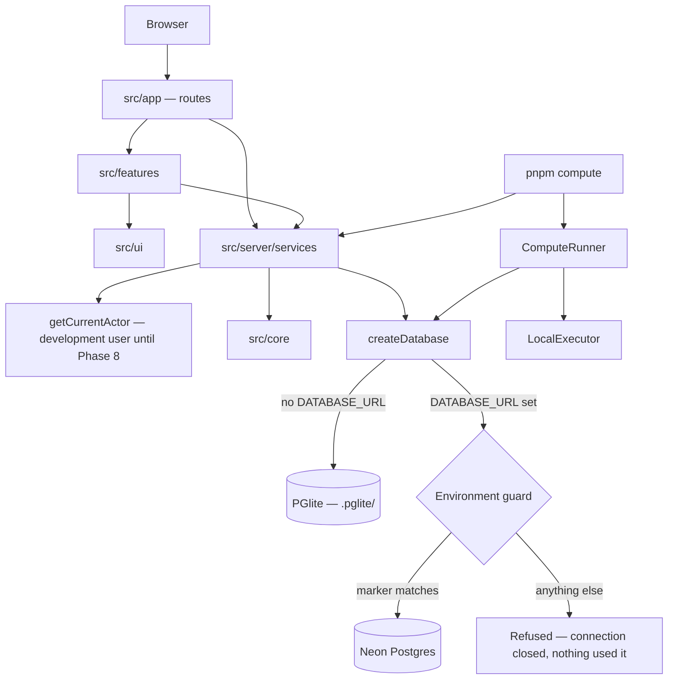

# Architecture

Faultline is a single Next.js application with enforced internal layers, backed by
PostgreSQL. This document describes how it is put together and the decisions that
shape it. For the compute layer in depth, see [compute.md](compute.md); for the
database environment guard, see [database-environment.md](database-environment.md).

Status labels used here: **implemented**, **in progress**, **planned**.

---

## Layers

Layers are ordered innermost-first. Each may depend only on the layers above it.

| Layer | Responsibility | Status |
| --- | --- | --- |
| `content/` | Authored problems, concepts and canonical reasoning. Data, not code. | Implemented (integer subtraction) |
| `src/core/` | Pure domain logic: answer checking, content schema, submission rules, compute contracts, database-guard decisions, reasoning-comparison contracts. No framework, database, network or AI. | Implemented; reasoning parts in progress |
| `src/ai/` | Provider-agnostic model layer: one module per model call, each with its own output schema, prompt version and retry policy. | Planned — only its contract (`src/ai/README.md`) exists |
| `src/server/` | Persistence, services, compute, configuration and the development actor. Server-only. | Implemented |
| `src/ui/` | Design-system primitives, layout, feedback and the reasoning-path visual. | Implemented |
| `src/features/` | Feature composition (the reasoning stepper). | Implemented |
| `src/app/` | Routes. Thin: they call services and compose features. | Implemented |

These rules are enforced by ESLint (`eslint.config.mjs`), so a violation fails
`pnpm lint` and CI:

- `src/core` may not import Next, React, `server-only` or any outer layer.
- `src/ai` may depend only on `src/core`, and may not import React or Next.
- `src/ui` may not import data, AI or feature code.
- `src/app` and `src/features` may not import `src/server/db`; they go through
  `src/server/services`.

## Runtime view

A request is handled by a route, which asks a service for data. The service resolves
the current actor, checks ownership and authorization, and uses the database. Pure
decisions (is this answer correct, is this state transition legal, does this marker
match) are made by functions in `src/core`, which are tested without a database.

## Data model

Defined in `src/server/db/schema.ts`; migrations in `src/server/db/migrations/`.

| Table | Purpose |
| --- | --- |
| `users` | Accounts with a role: `student`, `teacher` or `admin`. Today only the development user exists. |
| `concepts`, `problems`, `problem_concepts`, `problem_misconceptions` | The authored problem set and what each problem exercises. |
| `reference_solutions`, `reference_steps` | Canonical reasoning: each step holds the expected reasoning **and** the prompt the student is shown. |
| `attempts` | One student's attempt: submitted answer, `answer_correct`, attempt status and reasoning status. |
| `reasoning_steps` | The student's steps, each paired with a reference step and an input method (`text` or `voice`). |
| `compute_jobs`, `compute_job_attempts` | The compute queue and every attempt to run a job. |
| `faultline_environment` | The single-row database environment marker. Written only by a person. |

## Key design decisions

### 1. `src/core` is pure

Answer checking, the compute state machine, database-guard decisions, confidence
policy and the reasoning-comparison contracts are deterministic functions over plain
data. They are testable with no API key, no database and no framework, and they cannot
quietly acquire side effects, because the linter forbids the imports that would allow
it.

### 2. Content is data

Problems, canonical reasoning and (later) the misconception taxonomy live in
`content/` as version-controlled data validated by `src/core/content/schema.ts`.
Supporting a new subject means adding content, not editing engines. Generated content
must be reviewed by a teacher before it enters `content/` (Phase 9).

### 3. Answer correctness and reasoning quality are independent

`answer_correct` and `reasoning_status` are separate columns from the first migration.
A correct answer reached by faulty reasoning is therefore representable before any
analysis exists. That case is the reason Faultline exists, and one authored problem is
built so that the most common wrong rule produces the right answer.

### 4. Step N answers reference step N

Each reference step stores both the canonical reasoning and the prompt the student was
asked, so a student's step N is by construction the response to reference step N.
Reasoning comparison (Phase 3) therefore needs no fuzzy alignment; the comparison
input (`src/core/reasoning/trace.ts`) only asserts that the pairing holds before any
comparison runs.

### 5. The model proposes; the application decides — planned

The Phase 3 reasoning-diff contract (`src/core/reasoning/diff-schema.ts`, in
progress) is the only shape of model output the application will accept. It
deliberately has **no misconception field**: in Phase 3 a model may say *where* and
*why* reasoning diverges, never *what kind* of error it is, so it cannot invent a
taxonomy label. Classification against a curated, closed taxonomy arrives in Phase 4.
Numeric bounds and cross-field rules are applied by tested application code, not
delegated to the model.

### 6. Confidence is policy in one place

Confidence thresholds live in `src/core/diagnosis/confidence.ts`. UI components render
the band they are given and never derive one. The current numbers are a starting
position, to be replaced with thresholds calibrated on an evaluation dataset
(Phase 10).

### 7. Diagnoses are evidence, not attributes — planned

Diagnoses will be append-only events rather than mutable properties of a student. A
student's map of faultlines is a query over evidence, which makes "observed 4 times"
expressible and "is bad at maths" inexpressible.

### 8. Real Postgres everywhere, with zero-credential development

PGlite is Postgres compiled to WebAssembly. Without `DATABASE_URL` the app uses a
PGlite database in `.pglite/`, migrated and seeded on boot, and the test suite uses
in-memory PGlite. The same schema, migrations, constraints and SQL run locally, in
tests and on Neon. PGlite is single-process, so a lock file prevents two processes
from opening the same directory.

### 9. Fail closed

- Production requires `DATABASE_URL` at runtime and fails at the first database
  access without it. Environment parsing is lazy, so `next build` needs no secrets.
- Every Neon connection passes the database environment guard first. A database that
  is unmarked, ambiguous, mismatched or unreadable is refused, and a production
  database is refused outside `NODE_ENV=production`. drizzle-kit is given an
  unresolvable address unless the guard has verified the database.

### 10. Authorization lives in services

Routes and components never query the database. Services take the current actor and
enforce ownership. Until Phase 8, `getCurrentActor()` (`src/server/auth/actor.ts`)
resolves a deterministic development user that is a real row in `users`, so ownership
boundaries are exercised now and Phase 8 replaces only that function's body.

### 11. Compute is a database-backed queue with a pluggable executor

- Jobs are rows; every state change is a compare-and-set update; the database enforces
  lifecycle invariants as check constraints. A runner holds no state that matters and
  can die at any point.
- A task is split into `load` (runs on the runner, inside a read-only transaction) and
  `run` (a function of its input alone). Because `run` needs no database, network or
  secrets, a future executor can ship it to another machine without shipping anything
  else.
- `ComputeExecutor` is the seam. `LocalExecutor` (in-process) is implemented and is the
  permanent fallback. **A distributed (Dask) executor is not implemented**; see
  [roadmap.md](roadmap.md#distributed-compute).

## Design system

Rendered live at `/design`. Two rules govern it:

1. **Colour carries meaning.** The interface is a warm neutral ground, so the one
   coloured thing on screen is the thing that matters. Each tone maps to exactly one
   state: `valid`, `suspect`, `faultline`, `repaired`, `uncertain`, `danger`.
2. **Structure comes from rules and spacing**, not shadows and cards.

The signature element is the **reasoning path** (`src/ui/reasoning/`). Where reasoning
diverges, the rail is *displaced* rather than reddened — the way strata are offset
across a geological fault — and later steps continue on the shifted line.
